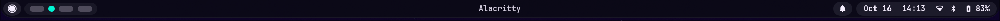

# Waybar Status Bar

Waybar serves as the primary top status bar in this desktop environment, engineered with a ChromeOS Shelf aesthetic, rounded capsule pills, and seamless IPC communication with [Quickshell](../quickshell/index.md) and the [Hyprland compositor](../hyprland/index.md).

---

## Architecture and File Map

* **Live symlink:** `~/.config/waybar` -> `~/dotfiles/waybar`
* **Configuration:** `~/.config/waybar/config.jsonc` (module layout and actions)
* **Stylesheet:** `~/.config/waybar/style.css` (visual properties and ChromeOS pill styling)
* **Dynamic Palette:** `~/.config/waybar/colors.css` (imports `~/.config/themes/current/waybar.css` generated by [Matugen](matugen.md))
* **Helper Scripts:**
    * `~/.config/waybar/scripts/notifications`: Reads real-time notification queue state
    * `~/.config/waybar/scripts/mediaplayer`: MPRIS playback monitor with 40-character ticker marquee and Quickshell Dynamic Island integration
    * `~/.config/waybar/scripts/powerprofile`: Real-time power profiles daemon monitor and toggle (`power-saver`, `balanced`, `performance`)

---

## Layout and Modules

Waybar is docked at the top of the display with a height of 36 pixels and an accented 2 px bottom border (`border-radius: 0; border-bottom: 2px solid @accent;`) engineered for seamless, organic Dynamic Island integration with Quickshell dropdown panels:

```text
+-------------------------------------------------------------------------------------------------------+
| [Launcher] [Workspaces]               [Now Playing Pill]                [Tray] [Notifs] [Unified System Pill] |
+-------------------------------------------------------------------------------------------------------+
```



### 1. Left Section
* **`custom/launcher`:** Circular action button styled after the ChromeOS app launcher. Clicking executes `qs ipc call launcher toggle` to display the Quickshell application drawer.
* **`hyprland/workspaces`:** Pill container with dynamic indicators. Inactive workspaces appear as muted capsule pills, while the active workspace morphs into an accented circular indicator.

### 2. Center Section
* **`custom/media`:** Centralized ChromeOS capsule pill (`border-radius: 18px`, `min-width: 260px`, `background: alpha(@text, 0.08)`) displaying currently playing media with a smooth 40-character marquee ticker:
    * **Marquee Dynamics:** Automatically rotates long track titles (`0.5s` steps) with clean loop separation (`•`), freezing cleanly in place upon pause and collapsing completely (`.empty`) when no media is active.
    * **Left Click:** Executes `qs ipc call mediaselector toggle`, smoothly opening the Quickshell Dynamic Island media source dropdown.
    * **Right Click:** Toggles play/pause state via `playerctl play-pause`.
    * **Mouse Scroll:** Navigates tracks via `playerctl next` (scroll up) and `playerctl previous` (scroll down).
    * **Global Tooltips:** Clean, non-intrusive status tooltip (`Playing...` / `Paused...`) styled globally with Matugen-themed container colors and rounded corners (`border-radius: 12px`).

### 3. Right Section
* **`tray`:** Wayland system tray for background application icons (`icon-size: 14px`, `spacing: 8px`). The container collapses to zero width and margins when empty, rendering active icons inside rounded capsule badges (`border-radius: 14px`, `background: alpha(@text, 0.08)`).
* **Quick Actions & Notifications Pill (`group/quick_actions`):**
    * Unified capsule pill hosting quick hardware indicators alongside the notification bell and clipboard manager (`custom/caffeine`, `custom/nightlight`, `custom/shader`, `custom/powerprofile`, `custom/notifications`, `custom/clipboard`).
    * **Empty state collapse:** When all quick toggles are inactive, the pill seamlessly scales to contain solely the notification bell and clipboard button, eliminating any residual empty container spacing or layout shifts.
    * **Active indicators:** When one or more toggles are engaged, their accented glyphs (`color: @accent`, `font-size: 16px`) appear inline to the left of the notification bell, sharing the unified capsule container (`border-radius: 18px`, `background: alpha(@text, 0.08)`).
    * **`custom/caffeine`:** Displays coffee cup glyph (`󰅶`) when session wake-lock is engaged via POSIX signal `SIGRTMIN+8`.
    * **`custom/nightlight`:** Displays eye glyph (`󰈈`) when `hyprsunset` warm light filter (4000K) is active via POSIX signal `SIGRTMIN+9`.
    * **`custom/shader`:** Displays screen shader glyph (`󰸉`) when screen decoration shader is applied via POSIX signal `SIGRTMIN+10`.
    * **`custom/powerprofile`:** Displays active power profile glyphs when operating outside the balanced default: leaf glyph (`󰌪`) for `power-saver` or speedometer glyph (`󰓅`) for `performance`. Completely collapses in `balanced` mode. Synchronizes instantly via POSIX signal `SIGRTMIN+11` from Quickshell Control Center and power profile daemon events. Left click cycles profiles; right click opens the Quickshell Energy & Performance dashboard.
    * **`custom/notifications`:** Notification bell integrated with Quickshell Notification Service and DND state:
        * Displays standard bell glyph (`󰂚`) in neutral text color (`@text`) when notification history is empty.
        * Displays bell glyph with unread count (`󰂚  [N]`) highlighted in accent color (`@accent`) when notifications are pending.
        * Morphs dynamically into the Do Not Disturb glyph (`󰂛  [N]` or `󰂛`) highlighted in accent color (`@accent`) when DND mode is enabled.
        * Synchronizes in real time via POSIX signal `SIGRTMIN+1`.
        * Left click invokes `qs ipc call notifications toggle`, opening the Control Center with the notifications card expanded.
    * **`custom/clipboard`:** Clipboard manager action button displaying clip glyph (`󰅌`). Left click invokes `qs ipc call clipboard toggle`, opening the Quickshell bottom-sliding [Clipboard Manager](../quickshell/clipboard.md).
* **Unified Status Pill:** Merged continuous capsule pill containing date, time, audio, network, bluetooth, and battery/power:
    * **`custom/date`:** Formatted date (`date +'%b %d'`), styled as the rounded left edge of the unified pill.
    * **`clock`:** Local time format `{:%H:%M}` with bold typography.
    * **`pulseaudio`:** Volume glyphs; click toggles Quickshell Control Center, right-click opens `pavucontrol`, and mouse wheel scrolling adjusts sink volume using `wpctl set-volume`.
    * **`network`:** Wi-Fi / Ethernet state; click opens Quickshell Control Center.
    * **`bluetooth`:** Adapter state and connection count; click opens Quickshell Control Center. Features an optical size increase (18px) when active, and collapses to zero width (`format-disabled: ""` and `format-off: ""`) when Bluetooth is powered off.
    * **`battery` / `custom/power`:** Charge percentage, charging animations, and battery warnings (laptop) or power state (desktop), styled as the rounded right edge of the unified pill.

---

## Integration with Quickshell and Hyprland

Waybar and Quickshell operate in synchronized coexistence:

1. **Vertical Hierarchy:**
   * Waybar occupies the top 36 pixels (`height: 36`, `layer: top`).
   * Quickshell floating toasts and OSDs reserve a `topMargin: 46` px, creating an aligned 10 px air gap directly below Waybar's rounded bottom border (see [Notifications & OSDs](../quickshell/osd-notifications.md)).
2. **IPC Interactivity:**
   * Clicking audio, network, or bluetooth indicators directly opens the One UI Control Center inside Quickshell.
   * Clicking the launcher circle opens the Quickshell app search matrix without requiring full-screen interruptions.
3. **Real-time Signal Sync (`SIGRTMIN+1`):**
   * Quickshell writes unread counts to `/tmp/qs-notif-count` and issues `pkill -RTMIN+1 waybar`, triggering immediate redraws without CPU polling overhead.

---

## Dynamic Palette Integration (Matugen)

Colors and translucency tokens are imported dynamically from the centralized theme store:

```css
/* ~/.config/waybar/colors.css */
@import url("/home/zero/.config/themes/current/waybar.css");
```

### Supported Color Tokens
* `@bg`: Canvas backdrop with 80% alpha opacity (`alpha(@bg, 0.80)`).
* `@text`: Primary typography and icon color.
* `@accent`: Active workspace indicator and highlight borders.
* `@warning`: Battery low threshold (<= 30%).
* `@critical`: Battery critical threshold (<= 10%).
* `@charging`: Battery active power supply state.

### Reloading Waybar Stylesheet Live
To reload Waybar styling without restarting the process:

```bash
pkill -SIGUSR2 waybar
```

---

## Related Documentation

* [Quickshell Overview](../quickshell/index.md): Control Center, desktop widgets, and IPC endpoints.
* [Notifications & OSD Dynamics](../quickshell/osd-notifications.md): Detailed vertical spacing and toast geometry beneath Waybar.
* [Hyprland Architecture](../hyprland/index.md): Autostart definitions and window management rules.
* [Matugen Theming Engine](matugen.md): Color extraction pipeline and `waybar.css` template generation.
* [Wofi Application Launcher](wofi.md): Secondary standalone menu runner.
* [Documentation Home](../index.md): Navigation index for the dotfiles repository.
