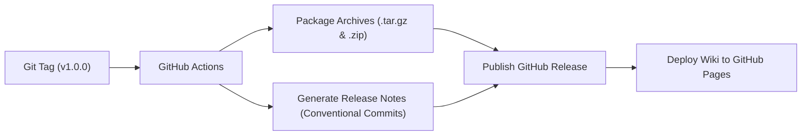

# Release Management & SemVer

This repository follows [Semantic Versioning 2.0.0](https://semver.org/) (`vMAJOR.MINOR.PATCH`) and [Conventional Commits](https://www.conventionalcommits.org/) to automate versioning, release artifacts, and documentation deployment.

---

## 🏷️ Versioning Scheme

* **MAJOR (`vX.0.0`):** Incompatible architectural overhauls (e.g. switching compositor, complete directory reshuffling).
* **MINOR (`v1.X.0`):** New features, widgets, or apps added backward-compatibly (e.g. adding an OCR tool, new Quickshell modules).
* **PATCH (`v1.0.X`):** Backward-compatible bug fixes, minor CSS styling tweaks, or performance optimizations.

---

## 🚀 How to Trigger a Release

You have two convenient ways to cut a new release:

### Option 1: From Your Terminal (CLI Helper)

Run the included release script in the repository:

```bash
# Interactive mode (prompts for patch, minor, major, or custom)
./scripts/release.sh

# Or directly specify the bump type:
./scripts/release.sh patch   # e.g. v1.0.0 -> v1.0.1
./scripts/release.sh minor   # e.g. v1.0.0 -> v1.1.0
./scripts/release.sh major   # e.g. v1.0.0 -> v2.0.0
./scripts/release.sh v1.0.0  # explicit version
```

The script will:
1. Verify that your git working tree is clean.
2. Determine the next SemVer tag.
3. Create the annotated git tag.
4. Push both `main` and the new tag to GitHub.

---

### Option 2: From GitHub Actions (Web UI)

1. Navigate to your repository on GitHub: `https://github.com/zer0sh/dotfiles/actions`.
2. Select the **Release & Deploy** workflow on the left sidebar.
3. Click **Run workflow**.
4. Choose the bump type (`patch`, `minor`, `major`) or enter a custom version.
5. Click the green **Run workflow** button.

---

## ⚙️ Automated Pipeline (What Happens on Release)

When a release tag is pushed (`v*.*.*`):



1. **Release Notes:** GitHub automatically categorizes commits into Features, Bug Fixes, and Maintenance based on Conventional Commits.
2. **Packaged Assets:** Generates clean `dotfiles-vX.Y.Z.tar.gz` and `dotfiles-vX.Y.Z.zip` archives attached to the release for easy distribution or disaster recovery.
3. **Wiki Deployment:** Compiles and deploys the latest MkDocs documentation to [zer0sh.github.io/dotfiles](https://zer0sh.github.io/dotfiles/).
