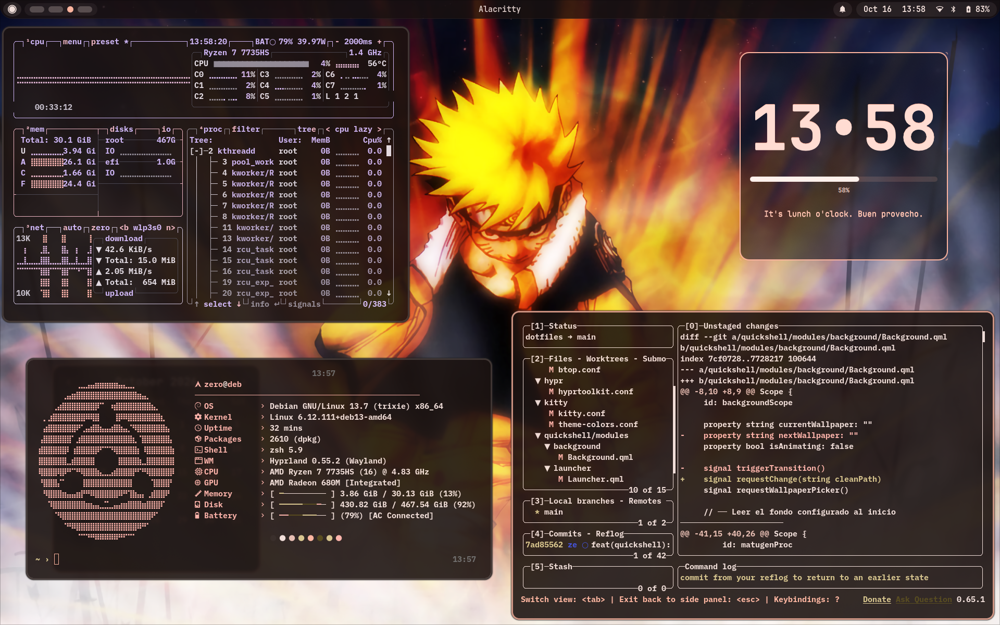
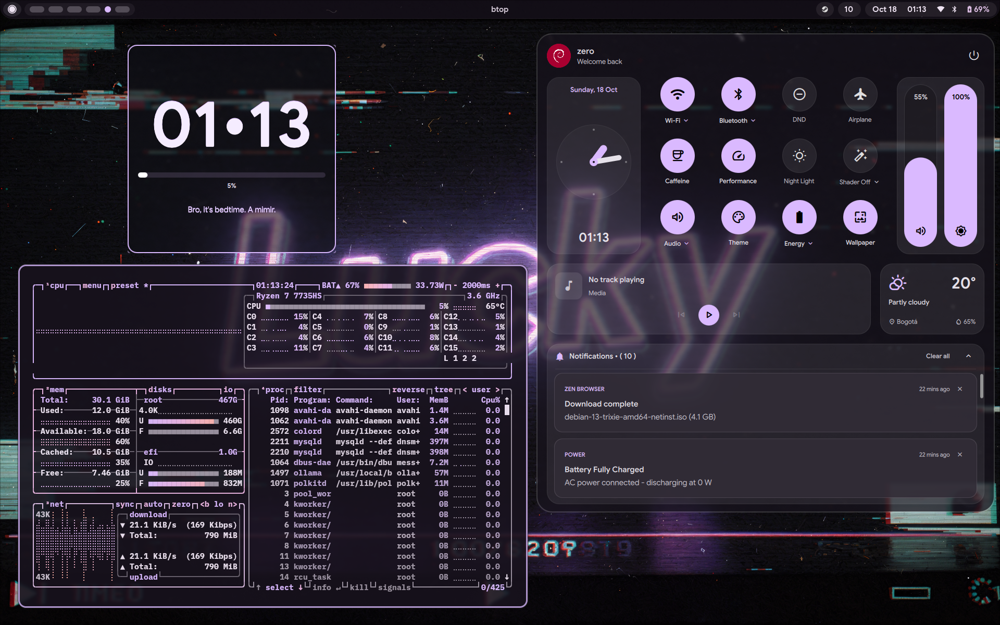
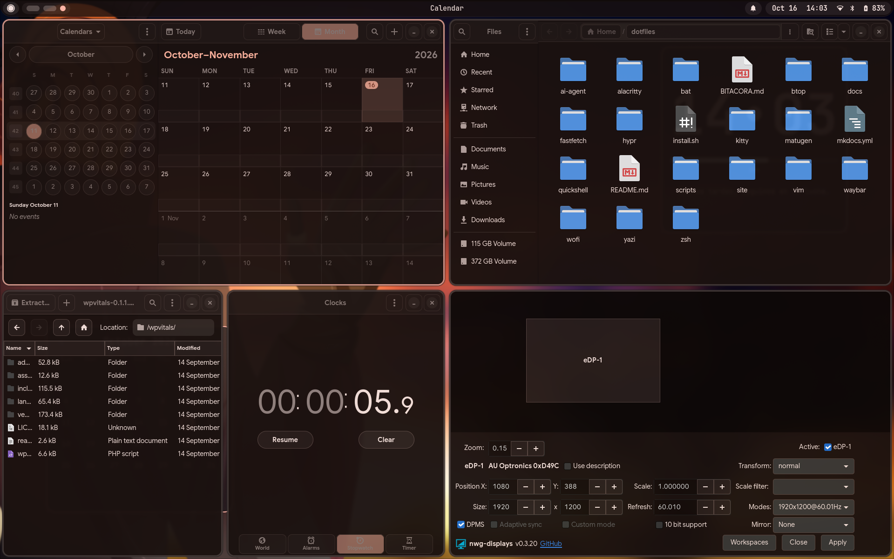
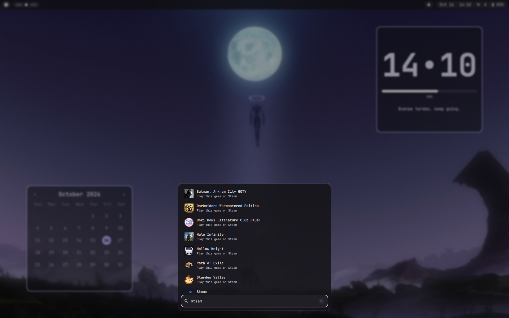
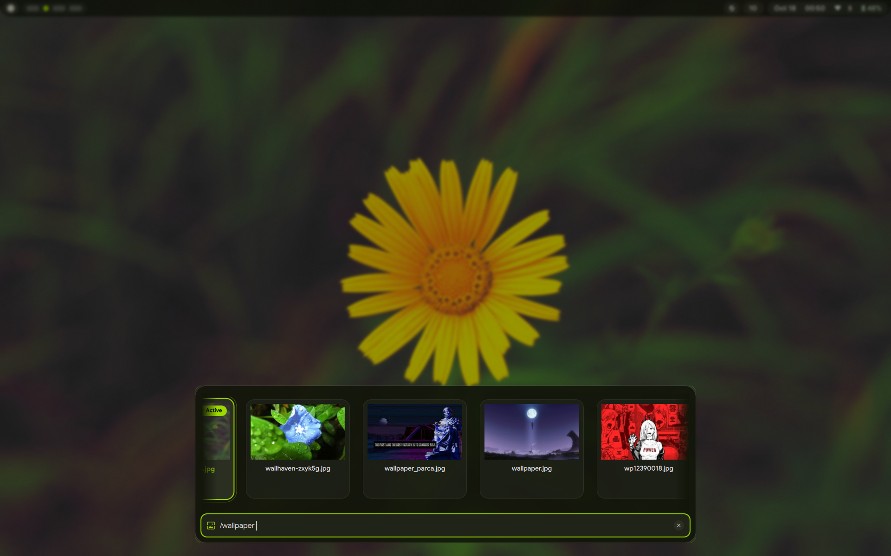
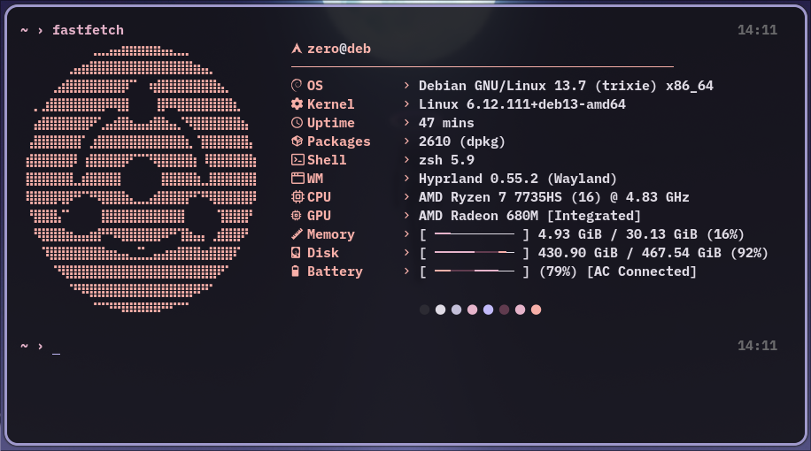
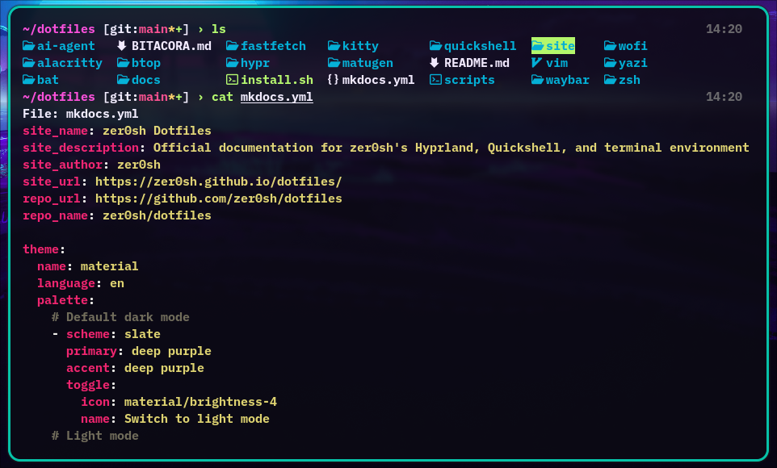
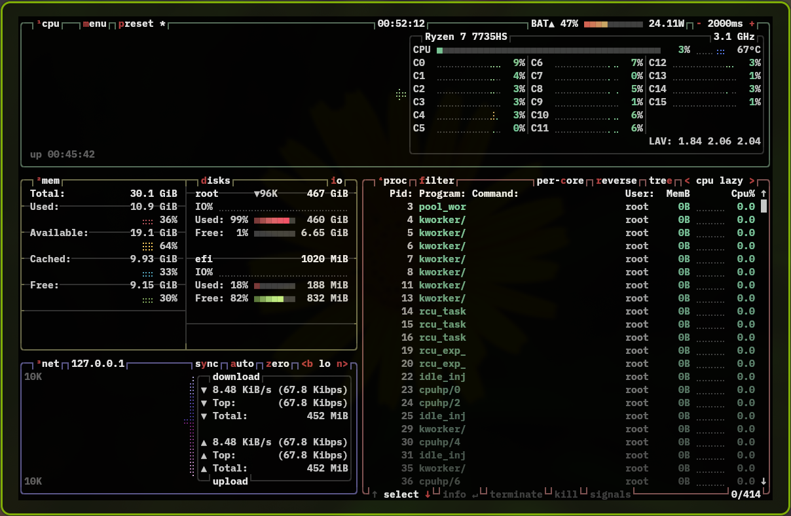
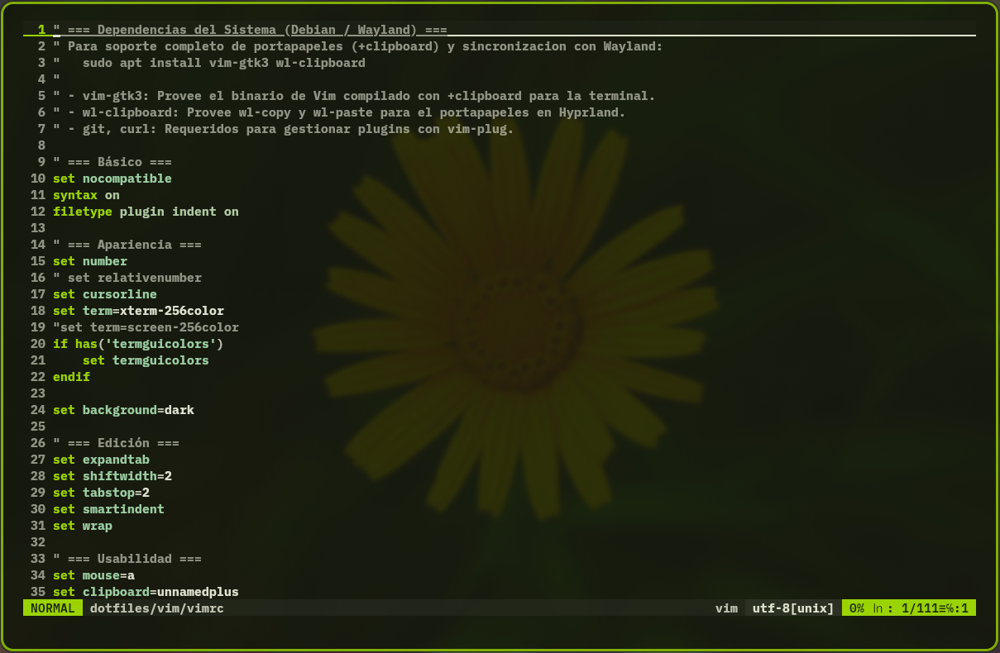

# Visual Showcase & Gallery

A visual catalog demonstrating the aesthetic cohesion, Material Design 3 theming, window tiling, and utility suite configured across zer0sh's dotfiles environment.

---

## 1. Desktop & Tiling Overview

A full overview of the Hyprland tiling workspace featuring Alacritty, Fastfetch telemetry, Lazygit for interactive version control, desktop clock widget, and the top-centered Waybar pill status bar.

### Key Elements Highlighted:
* **Tiling Composition:** Active window borders automatically accented with colors generated by Matugen from the desktop wallpaper.
* **Status Pill (Waybar):** Centralized navigation pill displaying workspaces, active window title, and system tray.
* **Terminal Diagnostics:** Fastfetch providing hardware telemetry, shell load timings, and system specs.
* **Git Workflow:** Lazygit running natively inside Alacritty using BlexMono Nerd Font typography.

---

## 2. GNOME & GTK Applications Suite

Dynamic Material You theming applied universally to modern (GTK 4 / Libadwaita) and classic (GTK 3) applications.

### Applications Featured:
* **GNOME Calendar (`gnome-calendar`):** Monthly agenda layout adopting current surface and accent color schemes.
* **Nautilus (`nautilus`):** GNOME Files manager adhering to system dark mode and custom sidebar tokens.
* **File Roller (`file-roller`):** Classic archive manager rendered with matching window and header bar styling.
* **GNOME Clocks (`gnome-clocks`):** World clock and stopwatch utilities running under unified dark palette.
* **nwg-displays (`nwg-displays`):** Wayland monitor layout and resolution configuration tool.

---

## 3. Modular Status Bar (Waybar)

ChromeOS Shelf-inspired top status bar engineered with rounded capsule pills, dynamic workspace morphing, and a unified system indicator pill.

### Key Features:
* **Launcher Button:** Invokes the Quickshell application drawer and wallpaper switcher via IPC.
* **Workspaces:** Active workspace dynamically expands into an accented circular indicator.
* **Unified Status Capsule:** Blends date, time, audio volume, network, bluetooth, and battery monitoring into a single continuous pill.

---

## 4. Application Launcher (Wofi)

Dynamic Material Design 3 application launcher featuring centralized fuzzy search, desktop application indexing, and live color styling generated by Matugen.

### Key Features:
* **Fuzzy Matching:** Instant filtering across installed applications and utilities.
* **Palette Sync:** Background surfaces, selection highlights, and borders dynamically derived from wallpaper tones.
* **Design Presets:** Built-in support for Material Card, Spotlight, and Grid layouts switchable via `switch-preset.sh`.

---

## 5. Quickshell Desktop Layer

### Floating Launcher & Wallpaper Carousel

The Material Design 3 launcher opened in wallpaper mode (`/wallpaper` or `SUPER + W`), rendering a horizontal carousel of 16:9 previews with the active wallpaper highlighted by an accent glow.

### Notification Toasts & OSD Cards

Floating notification toasts stacking downwards from the top-center of the display, each with its application badge, title, and body text.

Translucent volume and brightness OSD cards rendered with the same Material You surface tokens, auto-dismissing after two seconds of inactivity.

### Key Features:
* **Wallpaper Carousel:** Fuzzy-filtered wallpaper browser with cached thumbnails, keyboard navigation, and apply-on-enter behaviour.
* **Toast Queue:** New notifications are prepended into the top slot and push older cards downwards through a `move` transition (maximum of four concurrent toasts).
* **OSD Placement:** 360 x 56 px cards anchored 46 px below the 36 px Waybar strip, so status indicators remain visible while the card animates in.
* **Palette Sync:** Lazily instantiated Wayland layershell surfaces styled exclusively from Matugen `surface_container`, `outline`, and `on_surface` tokens.

---

## 6. Terminal & CLI Utilities

### Fastfetch System Telemetry
Custom braille logo art, structured key-value hardware specifications, dual-line progress bars (RAM, disk, battery), and active Matugen color swatches.

### Bat Syntax Pager & Cat Replacement
Modern replacement for `cat` configured with clean headers, language-specific syntax highlighting, tab standardization, and non-paging streaming stdout.

### btop Resource Monitor
Full terminal dashboard rendering CPU, memory, disk, and process panels with the Matugen palette generated from the active wallpaper.

### Vim Dynamic Theme Setup
The repository `vimrc` running under the `matugen` colorscheme, with the synchronized vim-airline statusline at the bottom.

