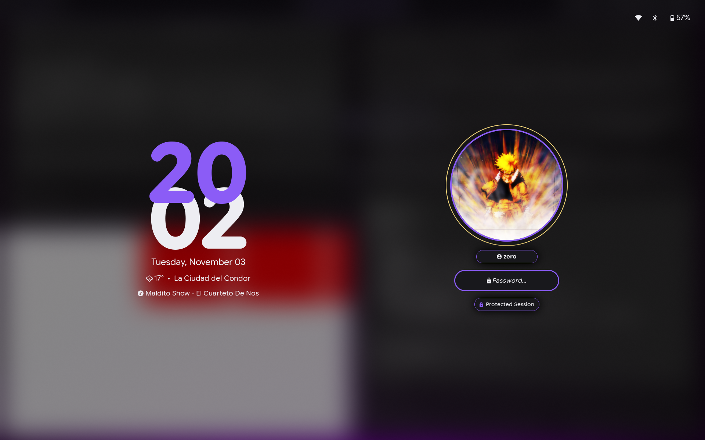

# Screen Locking & Idle Management (Hyprlock & Hypridle)

Session security and power conservation are handled natively within the Hyprland ecosystem using **Hyprlock** (fast, graphical Wayland screen locker) and **Hypridle** (Wayland-native idle daemon).

---

## Visual Showcase



---

## File Locations & Symlinks

* **Hyprlock configuration:** `~/dotfiles/hypr/hyprlock.conf` -> `~/.config/hypr/hyprlock.conf`
* **Hypridle configuration:** `~/dotfiles/hypr/hypridle.conf` -> `~/.config/hypr/hypridle.conf`
* **Dynamic color palette:** `~/.config/themes/current/hyprlock.conf` (generated by Matugen)
* **User profile avatar:** `~/dotfiles/hypr/avatar.png` -> `~/.config/hypr/avatar.png`
* **Auxiliary status & widget scripts:** `~/dotfiles/hypr/scripts/` (`weather`, `media`, `status`, `network`, `bluetooth`, `battery`)
* **Keybindings definition:** `~/dotfiles/hypr/binds.conf`
* **Autostart registration:** `~/dotfiles/hypr/autostart.conf`

---

## Hyprlock Architecture

Hyprlock generates a real-time frosted glass lock screen that adapts dynamically to the current wallpaper and active Material You color palette.

### 1. Dynamic Theming (Matugen Integration)

Color tokens are evaluated by Matugen and imported directly into `hyprlock.conf`:

```ini
source = /home/zero/.config/themes/current/hyprlock.conf
```

Available color roles include:
* `$accentColorPurple`: Primary accent used for borders, active hour numbers, and validation states.
* `$bgColorSecondary`: Inner background container for the input field and pill chips.
* `$textColor`: High-contrast font color for minutes, date, and auxiliary labels.
* `$textColorDanger`: Error state indicator for incorrect password attempts.
* `$accentColorAttention`: Warning color indicating Caps Lock activation and outer avatar ring.

### 2. Dual-Panel Pixel Architecture

Hyprlock utilizes **Google Sans Flex Rounded** typography with Nerd Font fallback icons, arranged in an asymmetric dual-panel composition:

```
[ Top Right: System Status (󰤨  󰂯  󰂄 57%) ]

       LEFT PANEL                                   RIGHT PANEL
   (Clock & Telemetry)                           (Profile & Auth)

          20 (Accent)                            [  Avatar  ]
          02 (Text)                              (Circular Halo)
    Tuesday, November 03
 󰖗 17° • La Ciudad del Condor                     [  󰀉 zero  ]
  󰎆 Song - Artist Name                           [ ✱✱✱✱✱✱✱✱ ]
                                              [ 󰌾 Protected Session ]
```

### 3. Smooth Transitions & Animations

Locking and unlocking sequences are governed by a customized Material Design 3 easing curve:

```ini
animations {
  enabled = true
  bezier = md3_decel, 0.05, 0.7, 0.1, 1.0
  bezier = md3_accel, 0.3, 0.0, 0.8, 0.15
  bezier = linear, 1, 1, 0, 0

  # Smooth fade-in on lock and fade-out on unlock
  animation = fadeIn, 1, 5, md3_decel
  animation = fadeOut, 1, 5, md3_accel
  animation = inputFieldDots, 1, 3, md3_decel
}
```

* **`fadeIn` (500ms):** Smoothly transitions from the active workspace to the blurred lockscreen without harsh screen tearing or black flickers.
* **`fadeOut` (500ms):** Gently dissipates lockscreen widgets and ambient blur back into the running session upon successful authentication.
* **`inputFieldDots` (300ms):** Interpolates input glyphs smoothly while typing.

### 4. Monumental Stacked Clock & Widgets

* **Stacked Hours & Minutes:** Sized at unified **172 pt** (`font_size = 172`) with the hours rendered on top, creating a subtle overlapping silhouette characteristic of Google Pixel / Material You lock screens.
* **Localized Weather & Custom Label:** Calls `~/.config/hypr/scripts/weather` which displays live temperature, weather icon, and the user's custom location label (`display_city`) configured via Quickshell Settings.
* **Media Telemetry:** Calls `~/.config/hypr/scripts/media` to reflect ongoing MPRIS audio playback.

### 5. Profile & Input Pill

```ini
input-field {
  monitor =
  size = 280, 52
  outline_thickness = 3
  dots_size = 0.22
  dots_spacing = 0.25
  dots_center = true
  dots_text_format = ✱
  font_family = $font
  outer_color = $accentColorPurple
  inner_color = $bgColorSecondary
  font_color = $textColor
  fade_on_empty = false
  placeholder_text = <span foreground="##$textColorHex"><i>󰌾 Password...</i></span>
  hide_input = false
  rounding = -1
  check_color = $accentColorPurple
  fail_color = $textColorDanger
  fail_text = <i>$FAIL <b>($ATTEMPTS)</b></i>
  capslock_color = $accentColorAttention
  position = 420, -165
  halign = center
  valign = center
}
```

* **Heavy Asterisk Glyph:** Utilizes `dots_text_format = ✱` for crisp, stylized password feedback.
* **Dynamic Indicators:** Outline turns red on authentication failure (`$textColorDanger`) and warning color on Caps Lock (`$accentColorAttention`).

### 6. Background Rendering

```ini
background {
  monitor =
  path = screenshot
  blur_passes = 3
  brightness = 0.55
}
```

* **Screenshot Capture:** `path = screenshot` grabs the active Wayland framebuffer upon invocation.
* **Frosted Glass Blur:** Evaluates 3 blur passes and dims brightness to `0.55` to obscure sensitive content while preserving ambient desktop aesthetics.

---

### 7. Auxiliary Scripts (`~/dotfiles/hypr/scripts/`)

All lockscreen scripts are optimized for zero-latency execution (< 2ms) without synchronous network blocking:

* **`weather` (`~/.config/hypr/scripts/weather`):** Reads cached weather data (`~/.cache/weather.json`) generated by Quickshell, mapping WWO condition codes to Nerd Font glyphs (`󰖙`, `󰖕`, `󰖐`, `󰖗`, `󰼲`, `󰙾`, `󰖑`) and rendering the active temperature alongside either the custom label or the queried city (`17° • La Ciudad del Condor`).
* **`media` (`~/.config/hypr/scripts/media`):** Communicates with active MPRIS players via `playerctl`. When music is playing or paused, displays `󰎆 Song - Artist` (or `󰏤`). When stopped or absent, displays fallback `󰎆 Playing now: The Void`.
* **`status` (`~/.config/hypr/scripts/status`):** Merges `network`, `bluetooth`, and `battery` into a single spaced string (`󰤨 󰂯 󰂄 57%`) to ensure pixel-perfect alignment.
* **`network` (`~/.config/hypr/scripts/network`):** Non-blocking interface status check (`/sys/class/net/*/operstate`) displaying `󰈀` (Ethernet), `󰤨` (Wi-Fi), or `󰤭` (Disconnected).
* **`bluetooth` (`~/.config/hypr/scripts/bluetooth`):** Instant radio status check via `rfkill` displaying `󰂯` (Active) or `󰂲` (Disabled).
* **`battery` (`~/.config/hypr/scripts/battery`):** Fast capacity and AC status check via `/sys/class/power_supply/`.

---

## Hypridle Daemon Configuration

`hypridle` runs as a persistent background daemon launched from `autostart.conf`:

```ini
exec-once = hypridle
```

### Configuration (`hypridle.conf`)

```ini
general {
    before_sleep_cmd = hyprlock
    after_sleep_cmd = hyprctl dispatch dpms on
    ignore_dbus_inhibit = false
    lock_cmd = hyprlock
}

listener {
    timeout = 300
    on-timeout = hyprlock
}
```

* **Sleep Safeguard:** `before_sleep_cmd = hyprlock` guarantees the session locks immediately before system suspend or hibernation.
* **Wake Recovery:** `after_sleep_cmd = hyprctl dispatch dpms on` restores display power as soon as the system resumes.
* **Inactivity Rule:** `timeout = 300` automatically triggers `hyprlock` after 5 minutes of continuous user inactivity.

---

## Keybindings & Manual Invocation

| Shortcut | Action | Target Command | Reference |
| :--- | :--- | :--- | :--- |
| `SUPER + L` | Lock screen immediately | `hyprlock` | [Keybindings Catalog](keybinds.md) |

---

## Related Documentation

* [Hyprland Architecture](index.md): Master orchestrator, `autostart.conf`, and window management.
* [Hyprland Keybindings](keybinds.md): System lock shortcuts and window actions.
* [Matugen Theming Engine](../apps/matugen.md): Generating `hyprlock.conf` color roles dynamically from wallpapers.
* [Quickshell Control Center](../quickshell/index.md): Power menu integration and session control.
