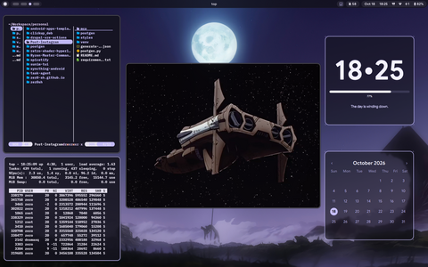
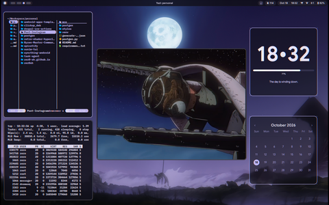
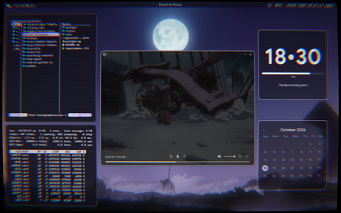
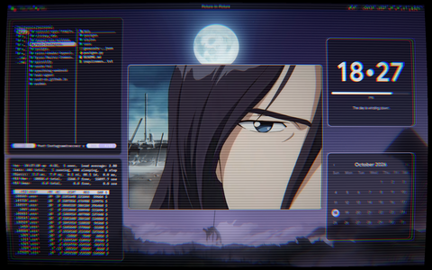
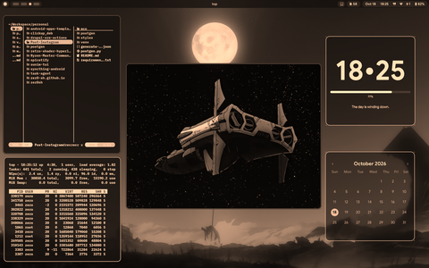
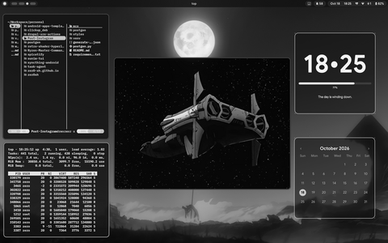
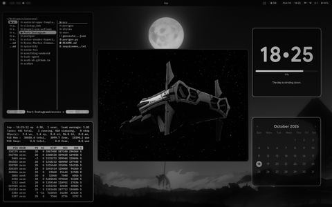
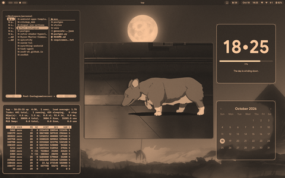
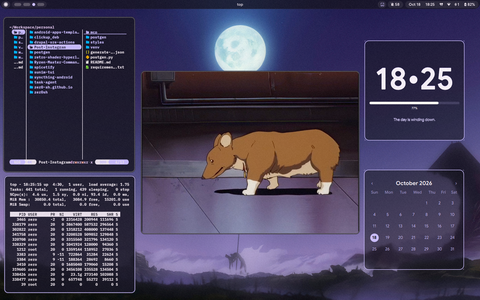

# Screen Shaders & Post-Processing

Hyprland provides real-time, hardware-accelerated post-processing screen shaders via OpenGL / Vulkan fragment shaders applied through `decoration:screen_shader`. The environment features an interactive visual carousel in Quickshell, keyboard shortcuts, and a collection of retro and stylistic color filters.

---

## Interactive Shader Carousel

The primary interface for browsing and applying shaders is the visual carousel integrated into the Quickshell floating launcher.

* **Dedicated Shortcut:** `SUPER + B` opens or toggles the shader carousel directly.
* **Control Center Integration:** The circular Shader tile in the Quickshell Control Center displays the current active filter label and opens the carousel with a single click.
* **Launcher Command:** Type `/shader` or `/filter` in the floating launcher.
* **Navigation:** Scroll with mouse wheel / touchpad, or navigate using Left / Right arrow keys, Tab, Shift+Tab, and press Enter to apply immediately.

---

## Available Shaders Gallery

The system includes 9 calibrated GLSL shaders located in `~/.config/hypr/shaders/`.

### 1. Shader Off (Passthrough)
* **File:** `off.glsl`
* **Description:** Default unshaded passthrough state with neutral color reproduction and zero performance overhead.



### 2. Sony Trinitron
* **File:** `trinitron.glsl`
* **Description:** Faithful simulation of Sony Trinitron CRT aperture grille monitors. Features continuous vertical RGB subpixel phosphor stripes, flat vertical axis with subtle horizontal curvature, classic tungsten tension damping wires at 33% and 66% screen height, and rich black contrast.



### 3. CRT Soft
* **File:** `crt-soft.glsl`
* **Description:** Modern, subtle retro CRT filter optimized for programming and reading. Features ultra-fine horizontal scanlines (1100 frequency), balanced radial chromatic aberration (+5%), gentle edge vignetting, and minimal barrel distortion.



### 4. CRT Retro
* **File:** `crt.glsl`
* **Description:** Classic curved arcade/tube monitor effect. Features noticeable barrel distortion, prominent scanlines, radial RGB dispersion towards the corners, and phosphor luminance glow.



### 5. Sepia Vintage
* **File:** `sepia.glsl`
* **Description:** Warm, golden-brown tint reminiscent of 1930s early film photography with balanced luminance.



### 6. Black & White
* **File:** `bw.glsl`
* **Description:** Clean, high-contrast monochrome conversion using luminance weights `vec3(0.299, 0.587, 0.114)`.



### 7. Film Noir
* **File:** `noir.glsl`
* **Description:** Dramatic, moody monochrome with high-gamma contrast (`pow(gray, 1.4)`), pronounced perimeter vignette, and subtle procedural film grain.



### 8. Vintage
* **File:** `vintage.glsl`
* **Description:** Faded, aged paper color grading mixed with warm earth tones and subtle noise texture.



### 9. Vivid
* **File:** `vivid.glsl`
* **Description:** Enhanced color saturation and heightened vibrance for colorful wallpapers and multimedia playback.



---

## Keybindings & Shortcuts

| Shortcut | Action | Command / Target |
| :--- | :--- | :--- |
| `SUPER + B` | Open / Toggle Shader Carousel | `quickshell ipc call shaderpicker toggle` |
| `SUPER + CTRL + 1` | Apply Sepia Vintage | `~/.config/hypr/scripts/filter sepia` |
| `SUPER + CTRL + 2` | Apply Black and White | `~/.config/hypr/scripts/filter bw` |
| `SUPER + CTRL + 3` | Apply Film Noir | `~/.config/hypr/scripts/filter noir` |
| `SUPER + CTRL + 4` | Apply Vintage | `~/.config/hypr/scripts/filter vintage` |
| `SUPER + CTRL + 5` | Apply Vivid | `~/.config/hypr/scripts/filter vivid` |
| `SUPER + CTRL + 0` | Disable Shader (Off) | `~/.config/hypr/scripts/filter off` |

---

## Architecture & Directory Layout

```text
~/.config/hypr/
├── shaders/                     # GLSL shader files
│   ├── off.glsl
│   ├── trinitron.glsl
│   ├── crt-soft.glsl
│   ├── crt.glsl
│   ├── sepia.glsl
│   ├── bw.glsl
│   ├── noir.glsl
│   ├── vintage.glsl
│   └── vivid.glsl
└── scripts/
    └── filter                   # CLI backend and compositor dispatcher

~/.config/quickshell/
├── assets/shaders/              # 480x300 preview thumbnails for the carousel
└── modules/launcher/
    ├── Launcher.qml             # Floating carousel controller and mode switch
    └── ShaderCard.qml           # Card delegate with hover and active states
```

---

## How to Create and Add New Shaders

Follow this quick step-by-step guide to create, register, and integrate a new shader into both Hyprland and the Quickshell UI.

### Step 1: Write the GLSL Fragment Shader
Create a new `.glsl` file in `~/.config/hypr/shaders/<shader-name>.glsl`. Hyprland shaders use OpenGL ES 3.20 syntax:

```glsl
#version 320 es
precision highp float;

in vec2 v_texcoord;
uniform sampler2D tex;
out vec4 fragColor;

void main() {
    vec4 pix = texture(tex, v_texcoord);
    vec3 col = pix.rgb;

    // Apply custom color transformations here
    // Example: Invert colors
    col = 1.0 - col;

    fragColor = vec4(col, pix.a);
}
```

### Step 2: Register the Shader in the Filter Script
Open `~/.config/hypr/scripts/filter` and add a new case matching your shader name:

```bash
    myshader)
        apply_shader "My Custom Shader" "$SHADER_DIR/myshader.glsl"
        ;;
```

Update the usage message at the bottom of the script to include your new filter keyword.

### Step 3: Generate the Preview Thumbnail
Apply the shader and take a clean 480x300 px snapshot using `hyprctl` and `grim`:

```bash
# Apply your new shader
hyprctl keyword decoration:screen_shader "$HOME/.config/hypr/shaders/myshader.glsl"

# Capture and resize thumbnail
grim -o eDP-1 /tmp/raw_thumb.png
magick /tmp/raw_thumb.png -resize 480x300^ -gravity center -extent 480x300 "$HOME/.config/quickshell/assets/shaders/myshader.png"
rm -f /tmp/raw_thumb.png
```

### Step 4: Add the Entry to Quickshell Launcher
Open `~/.config/quickshell/modules/launcher/Launcher.qml` and append your shader to the `shadersList` array:

```qml
{
    id: "myshader",
    name: "My Custom Shader",
    filterName: "My Custom Shader",
    desc: "Short visual summary of the effect",
    thumb: shaderThumbDir + "myshader.png"
}
```

### Step 5: Reload and Verify
Reload Quickshell to pick up the changes:

```bash
~/.config/quickshell/restart-quickshell.sh
```

Press `SUPER + B` to verify that your new shader card appears with its thumbnail, title, and description, and activates on click or Enter.

---

## Related Documentation

* [Hyprland Keybindings](keybinds.md): Keybindings reference for window management and tool toggles.
* [Quickshell Control Center](../quickshell/index.md): FeatureTile toggles and ambient quick settings.
* [Hyprland Architecture](index.md): Modular configuration hierarchy.
