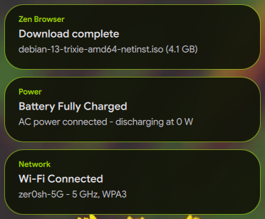

# Desktop Notifications & Toast Architecture

Quickshell implements a native notification daemon and floating toast presentation layer. Toasts emerge fluidly from beneath the Waybar top shelf using hardware-accelerated shapes, continuous accent borders, and dynamic queue transitions.

---

## Visual Reference



---

## Design Parameters and Dynamics

All floating notification toasts follow a strict geometry and motion contract:

1. **Dynamic Island Integration with Waybar:**
   * **Placement:** Anchored to the top of the monitor and centered horizontally (`anchors.top: true`, `anchors.horizontalCenter: parent.horizontalCenter`).
   * **Top Anchor:** Directly docked beneath Waybar (`topMargin: Root.Theme.shelfHeight`, 36 px) with zero dead space.
   * **Unified Shape & Continuous Accent Border:** Integrated into a unified `QtQuick.Shapes` geometry (`layer.enabled: true`, 4x multi-sampling) combining both 28 px concave shoulder fillets and the body into a seamless canvas. A continuous 2 px accent border (`strokeWidth: 2`, `strokeColor: Root.Theme.primary`, or `Root.Theme.error` on critical urgency) traces the left concave arc, down the flank, across the rounded base, and up the right concave arc while remaining cleanly open along the Waybar interface.
   * **Corner Radii:** Square top edge matching Waybar's bottom shelf and generously rounded bottom corners (`radius: 28`).
   * **Surface Finish:** Clean obsidian glass surface with exact opacity and color parity (`Qt.rgba(panelBg.r, panelBg.g, panelBg.b, 0.85)`). The top toast, Control Center, and media panels share this unified continuous border without interior seam lines or hover overlays.
2. **Theming:** Colors, translucency, and accents are rendered dynamically using [Matugen Dynamic Palette Tokens](../apps/matugen.md#core-color-roles) (`_shelfBgColor`, `primary`, `textPrimary`, `textSecondary`).
3. **Entrance Animation (Emergence from Waybar):**
   * Encapsulated within a clipped viewport (`clip: true`) so notifications physically slide out from beneath Waybar.
   * Translates from `_slideY: -height` to `0` over 280 ms using `Easing.OutCubic` acceleration.
   * Fades in opacity from `0` to `1` over 200 ms using `Easing.OutQuad`.
4. **Queue Dynamics:** When a new notification arrives, it prepends to the stack (`insert(0)`) and fluidly pushes older active notifications downward using `move: Transition`.
5. **Dismissal Animation:** Gently moves upward (`to: -height`) and fades out (`opacity: 0`) before unmounting from the model.
6. **LayerShell Surface Lifecycle & Input Masking:**
   * **Dynamic Loader Lifecycle:** The `PanelWindow` is instantiated via a `Loader { active: toastModel.count > 0 }`. When no toasts are active, the surface is completely unmapped from the Wayland compositor, eliminating stale layer surfaces.
   * **Targeted Surface Dimensions:** Anchored at `anchors.top: true` with `implicitWidth: 440` and dynamic height (`Math.min(700, Root.Theme.shelfHeight + toastCol.implicitHeight + 40)`).
   * **Layer `Top`:** Placed on `WlrLayer.Top`, preventing pointer grabs and focus disruption on normal desktop windows.
   * **Input Masking:** Uses `mask: Region { item: toastWrapper }` to restrict mouse interaction strictly to active notification cards and their concave fillets. All surrounding monitor areas pass pointer events directly through to underlying windows.

---

## File Structure

```text
quickshell/
└── modules/
    ├── notifications/
    │   ├── NotificationService.qml      # DBus service (org.freedesktop.Notifications) & store
    │   ├── NotificationToastLayer.qml   # Floating toast window with concave fillets
    │   ├── NotificationPopup.qml        # Single toast card delegate with action buttons
    │   └── NotificationItem.qml         # Card delegate for notification drawer in Control Center
    └── controlcenter/
        └── ControlCenter.qml            # Contains the collapsible notification history drawer
```

---

## History & Control Center Integration

* **Collapsible Drawer:** Inside `ControlCenter.qml`, notifications are aggregated into an expandable section titled `Notifications • ( # )`.
* **Action Header:** Includes a rotating chevron (180° transition) to collapse or expand the feed, alongside a "Clear All" action button.
* **Waybar Sync:** `NotificationService.qml` syncs the unread notification count with Waybar via custom signals, dynamically updating the notification badge in the status bar.

---

## Battery & System Daemon Alerts

Low-level hardware alerts are monitored by `~/.config/hypr/scripts/battery-notify` (started via `autostart.conf`). The script emits native Quickshell Dynamic Island notifications:

* **Charger Connection:** `󰂄 Charger Connected`
* **Charger Disconnection:** `󰂃 Charger Disconnected`
* **Low Battery (20%):** `󰁺 Low Battery (20%)` (Normal urgency)
* **Critical Battery (10%):** `󰂎 Critical Battery (10%)!` (Critical urgency, rendered with Material Design 3 error red styling)

---

## Testing & Verification

Send test notifications from terminal:

```bash
# Standard normal notification
notify-send "System Update" "All packages are synchronized with upstream repositories."

# Critical urgency alert (renders with error accent)
notify-send -u critical "Warning" "Core temperature exceeded normal operating thresholds."

# Notification with action buttons
notify-send --action="reboot=Restart Now" "Reboot Required" "A new kernel was installed."
```

---

## Related Documentation

* [On-Screen Displays (OSD)](osd.md): Volume, brightness, and MPRIS track transition overlays.
* [Control Center](index.md): Quickshell One UI Control Center and notification drawer.
* [Waybar Status Bar](../apps/waybar.md): Top status bar geometry and dock alignment.
* [Matugen Theming](../apps/matugen.md): Dynamic color generation and token mapping.
