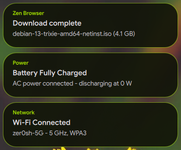
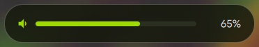
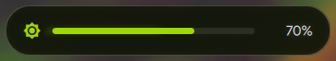

# Notifications & OSDs

This guide details the architecture, screen positioning, and animation dynamics for **floating notification toasts** and **on-screen display (OSD) cards** (Volume, Brightness, Music, and Mini Player) in [Quickshell](index.md) running on the [Hyprland compositor](../hyprland/index.md).

---

## Design Parameters and Dynamics

All floating indicators follow a standardized behavioral contract:

1. **Screen Placement:** Top of the screen, horizontally centered (`anchors.top: true`, `anchors.horizontalCenter: parent.horizontalCenter`).
2. **Top Margin:** `topMargin: 46 px` (reserves a comfortable visual gap beneath [Waybar's](../apps/waybar.md) 36 px height).
3. **Theming:** Colors, translucency, and borders are rendered using [Matugen Dynamic Palette Tokens](../apps/matugen.md#core-color-roles) (`surface_container`, `outline`, `on_surface`).
4. **Entrance Animation (Downward Slide):**
   * Translates from `_slideY: -28` to `0` over 260–280 ms using `Easing.OutCubic` acceleration.
   * Fades in opacity from `0` to `1` over 220 ms using `Easing.OutQuad`.
5. **Queue Dynamics:** When a new notification arrives, it occupies the top slot and fluidly pushes older active notifications downward using `move: Transition`.
6. **Dismissal Animation:** Gently moves upward (`to: -20`) and fades out (`opacity: 0`) before unmounting from the model.

---

## Visual Reference

Top-center notification toasts, each rendering the originating application, title, and body:



Volume and brightness OSD cards sharing the same placement, geometry, and surface tokens:





---

## Source Files Map

| Component | Source File | Responsibility |
| :--- | :--- | :--- |
| **Notification Service** | `modules/notifications/NotificationService.qml` | DBus server claiming `org.freedesktop.Notifications`, history store, and Waybar count signal sync. |
| **Toast Window** | `modules/notifications/NotificationToastLayer.qml` | Top floating window, model prepending (`insert(0)`), and column move transition. |
| **Notification Toast Card** | `modules/notifications/NotificationPopup.qml` | Floating card styling, slide-down appearance, and dismissal animations. |
| **Collapsible Notification Card** | `modules/controlcenter/ControlCenter.qml` | Embedded collapsible drawer with `Notifications • ( # )` title, 180° rotating toggle chevron, Clear all button, and scrollable card feed. |
| **Notification Feed Item** | `modules/notifications/NotificationItem.qml` | Individual notification item styling in the Control Center drawer. |
| **Volume OSD** | `modules/osd/VolumeOsd.qml` | Listens to PipeWire sink changes and animates top-center card. |
| **Brightness OSD** | `modules/osd/BrightnessOsd.qml` | Listens to `brightnessctl` and animates top-center card. |
| **Music Track Toast** | `modules/osd/MusicOsd.qml` | Automatic top-center popup on MPRIS track transition. |
| **Mini Music Player** | `modules/osd/MiniPlayer.qml` | Interactive player triggered via `SUPER + M` (see [Keybindings Catalog](../hyprland/keybinds.md#quickshell-and-desktop-overlays)). |

---

## Making Future Adjustments

### Adjusting Vertical Distance
Edit `topMargin` in the container `Item` or `toastCol`:
```qml
anchors.topMargin: 46 // Increase to push further down, decrease to lift closer to bar
```

### Changing Animation Speed
Inside the `appearAnim` block:
```qml
NumberAnimation {
    target: osdCard; property: "_slideY"
    from: -28; to: 0; duration: 260; easing.type: Easing.OutCubic
}
```

### Live Testing
* **Trigger notification:**
  ```bash
  notify-send "Test" "Smooth slide-down animation"
  ```
* **Trigger volume OSD:**
  ```bash
  wpctl set-volume @DEFAULT_AUDIO_SINK@ 5%+
  ```
* **Battery states:** this configuration exposes no battery OSD or IPC test
  hook, so warning and critical cards cannot be faked from the shell
  (`qs ipc call battery ...` returns `Target not found`). Battery warnings are
  rendered by Waybar's `battery` module, which switches to its `warning`,
  `critical` and `charging` states from live system data (see
  `waybar/config.jsonc`).

---

## Related Documentation

* [Waybar Status Bar](../apps/waybar.md): Top status bar geometry and vertical alignment with floating toasts.
* [Quickshell Overview](index.md): Main widget architecture, Control Center, and component index.
* [Hyprland Keybindings](../hyprland/keybinds.md): Audio, brightness, and utility shortcut bindings.
* [Hyprland Architecture](../hyprland/index.md): Autostart order and compositor lifecycle hooks.
* [Matugen Theming Engine](../apps/matugen.md): Dynamic surface and accent token definitions.
* [Screen Shaders](../hyprland/shaders.md): Visual filters toggled from the notification drawer and control center.
