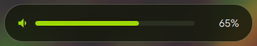
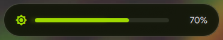

# On-Screen Display (OSD) Indicators

Quickshell implements hardware-accelerated on-screen displays (OSDs) for system volume, display brightness, and MPRIS track transitions. The OSD indicators share the top Dynamic Island geometry directly beneath Waybar, maintaining visual consistency across all temporary indicators.

---

## Visual Reference

Volume and brightness OSD cards sharing the same placement, concave fillets, and surface tokens:





---

## Design Parameters and Dynamics

All floating OSD cards share a unified styling contract:

1. **Waybar Dynamic Island Docking:**
   * **Placement:** Anchored to the top screen edge and centered horizontally (`anchors.top: true`, `anchors.horizontalCenter: parent.horizontalCenter`).
   * **Top Anchor:** Directly docked beneath Waybar (`topMargin: Root.Theme.shelfHeight`, 36 px) with zero dead space.
   * **Unified Shape & Continuous Accent Border:** Integrated into a unified `QtQuick.Shapes` geometry (`layer.enabled: true`, 4x multi-sampling) combining both 28 px concave shoulder fillets and the body into a seamless canvas. A continuous 2 px accent border (`strokeWidth: 2`, `strokeColor: Root.Theme.primary`) traces the left concave arc, down the flank, across the rounded base, and up the right concave arc while remaining cleanly open along the Waybar interface.
   * **Corner Radii:** Square top edge matching Waybar's bottom shelf and rounded bottom corners (`radius: 28`).
   * **Surface Finish:** Clean obsidian glass surface with exact opacity and color parity (`Qt.rgba(panelBg.r, panelBg.g, panelBg.b, 0.85)`).
2. **Animation Curves:**
   * **Entrance:** Extrudes downwards directly beneath Waybar with organic scale and cubic deceleration, fading opacity from `0` to `1`. Subsequent volume or brightness level changes smoothly interpolate the progress indicators without restarting the entrance extrusion animation.
   * **Dismissal:** Automatically dismisses after 2000 ms of inactivity, fading out and retracting upward over 190 ms.
3. **Input Handling:**
   * Placed on `WlrLayer.Overlay` with `WlrKeyboardFocus.None` to prevent stealing window focus during gaming or typing.
   * Dynamic input regions ignore mouse events, ensuring clicks pass through to underlying applications.

---

## Source Files Map

| Component | Source File | Responsibility |
| :--- | :--- | :--- |
| **Volume OSD** | `modules/osd/VolumeOsd.qml` | Listens to PipeWire / WirePlumber sink changes and animates level bar. |
| **Brightness OSD** | `modules/osd/BrightnessOsd.qml` | Monitors `brightnessctl` changes and animates backlight slider. |
| **Song Transition Toast** | `modules/osd/MusicOsd.qml` | Dynamic Island popup anchored to Waybar displaying thumbnail art, track title, and artist on MPRIS track transitions. |
| **Media Source Selector** | `modules/mediaselector/MediaSelector.qml` | Centered Dynamic Island dropdown panel with dual concave fillets, allowing live selection between Automatic and specific MPRIS players. |
| **Camera Quick Preview** | `modules/osd/CameraOsd.qml` | Persistent Dynamic Island webcam preview with double-buffered live feed, mirror toggle, snapshot action, and zero-idle background resource usage. |

---

## Testing & Hardware Integration

Trigger OSD popups directly from terminal or hotkeys:

### Volume OSD
```bash
# Raise volume
wpctl set-volume @DEFAULT_AUDIO_SINK@ 5%+

# Lower volume
wpctl set-volume @DEFAULT_AUDIO_SINK@ 5%-

# Toggle mute
wpctl set-mute @DEFAULT_AUDIO_SINK@ toggle
```

### Brightness OSD
```bash
# Increase display backlight
brightnessctl set +5%

# Decrease display backlight
brightnessctl set 5%-
```

### Song Transition OSD
```bash
# Skip to next MPRIS track
playerctl next
```

### Camera Quick Preview
```bash
# Toggle camera preview window
qs ipc call camera toggle

# Explicit show or hide
qs ipc call camera show
qs ipc call camera hide

# Take a direct snapshot
python3 ~/.config/quickshell/scripts/camera-preview.py snapshot
```

---

## Related Documentation

* [Desktop Notifications](notifications.md): Notification toasts and history drawer.
* [Waybar Status Bar](../apps/waybar.md): Top status bar geometry and dock alignment.
* [Hyprland Keybindings](../hyprland/keybinds.md): Media and brightness hardware keys.
* [Matugen Theming](../apps/matugen.md): Dynamic surface and accent token definitions.
