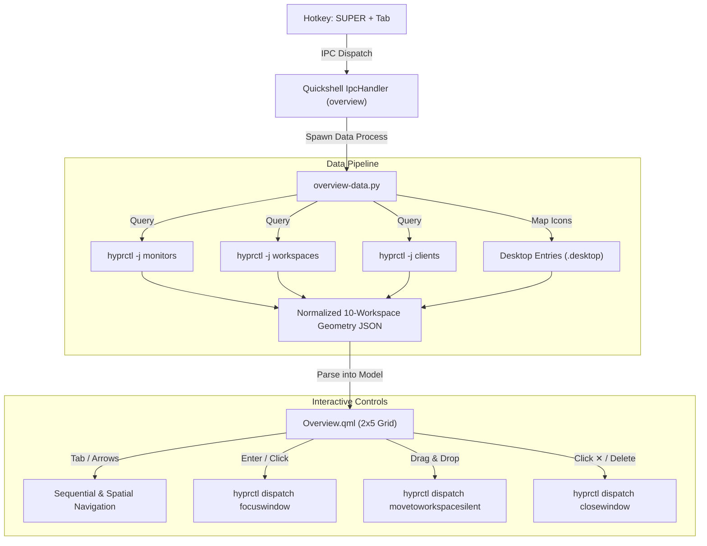

# Workspace Overview & Window Switcher

The Workspace Overview (`quickshell:overview`) is a Wayland-native, hardware-accelerated full-screen desktop exposé and window management modal built directly into Quickshell. Triggered globally via `SUPER + Tab`, it displays a 2×5 responsive grid representing all 10 Hyprland workspaces, accurately rendering window placements, and enabling drag-and-drop window relocation across workspaces.

---

## Architecture & Visual Overview



---

## File Structure

```text
quickshell/
├── modules/
│   └── overview/
│       └── Overview.qml             # Full-screen 2x5 grid modal and drag-and-drop manager
├── scripts/
│   └── overview-data.py             # 6ms Hyprland geometry normalizer & app icon resolver
└── shell.qml                        # Mutual exclusivity coordinator & IPC target registration
```

---

## Design Specifications

* **Surface Layout:** 2 rows of 5 columns displaying all 10 workspaces simultaneously:
  * **Top Row:** Workspaces 1, 2, 3, 4, 5
  * **Bottom Row:** Workspaces 6, 7, 8, 9, 10
* **Aspect Ratio Preservation:** Cards maintain the exact aspect ratio of the primary display (e.g. 16:10 for 1920×1200 or 16:9 for 1920×1080).
* **Workspace Numbering:** Prominent 22 px bold numeral positioned in the top-right corner of each card with a high-contrast outline, illuminated with `Theme.primary` when active or selected.
* **Proportional Scaling Mathematics:**
  $$\text{rel\_x} = \text{at}[0] - \text{monitor.x}, \quad \text{rel\_y} = \text{at}[1] - \text{monitor.y}$$
  $$\text{norm\_x} = \frac{\text{rel\_x}}{\text{monitor.width}}, \quad \text{norm\_y} = \frac{\text{rel\_y}}{\text{monitor.height}}$$
  Each window inside the card is placed at:
  $$x = \text{norm\_x} \times \text{card.width}, \quad y = \text{norm\_y} \times \text{card.height}$$
* **Minimum Window Enclosure:** Clamped to a minimum of 48×32 px to prevent sub-pixel collapse on heavily tiled windows, guaranteeing icon and title visibility.
* **Miniature Desktop Wallpaper:** Automatically renders the current desktop wallpaper (`~/.config/themes/current/wallpaper`) with an ambient darkened scrim behind each workspace canvas.
* **Zero Overhead Idle:** The overlay component is wrapped in a lazy `Loader { active: overviewScope.visible }`. When dismissed, all QML elements and processes are destroyed, using 0% CPU and 0 MB RAM.

---

## Core Features

### 1. Drag & Drop Window Relocation

Windows can be dragged directly between any of the 10 workspaces in plain sight:

1. **Drag Initiation:** Clicking and dragging any window card beyond an 8 px deadzone activates drag mode.
2. **Elevated Drag Ghost:** A floating card (135×44 px) follows the mouse cursor with a 95% opacity acrylic surface, the application's system icon, and live target text (*"Move to WS X"*).
3. **Workspace Hit-Testing:** A high-frequency timer tracks global cursor coordinates mapped into local canvas space (`mapFromItem`), dynamically highlighting candidate drop targets in connected accent green (`Theme.connected`).
4. **Silent Relocation Dispatch:** Upon release over a different workspace:
   ```bash
   hyprctl dispatch movetoworkspacesilent <target_ws>,address:<window_address>
   ```
   The compositor transfers the window silently without shifting the user's viewport, and the overview refreshes immediately.

### 2. Window Management & Identity

* **Desktop Icon Resolution:** `overview-data.py` inspects `/usr/share/applications`, `~/.local/share/applications`, and Flatpak export paths, pairing WM class names (`kitty`, `zen`, `Shortwave`) with system icon names fed to `Quickshell.iconPath()`.
* **Quick Close Button:** Hovering over any window reveals a `✕` close button in the mini-titlebar, invoking `hyprctl dispatch closewindow address:<addr>`.
* **Selected Window Inspector:** A bottom pill displays the focused application icon, app name, full window title, and active keyboard shortcuts.

### 3. Keyboard & Mouse Controls

| Input | Action |
| :--- | :--- |
| `SUPER + Tab` / `Tab` | Open overview / Cycle to next window across workspaces |
| `SUPER + SHIFT + Tab` / `Shift + Tab` | Cycle to previous window |
| `Arrow Keys` (`←`, `→`) | Move selection across adjacent workspaces |
| `Arrow Keys` (`↑`, `↓`) | Spatial 2D grid jump (moves ±5 workspaces between rows) |
| `1` – `9`, `0` | Instant jump to workspace 1–10 |
| `Enter` / `Space` | Focus selected window and close overview |
| `Delete` / `Backspace` | Close selected window |
| `Esc` / Click Outside | Close overview without changing focus |
| Click Window | Focus that window directly |
| Click Workspace Canvas | Switch directly to that workspace |
| Drag & Drop Window | Relocate window to target workspace |

---

## Mutual Exclusivity

The module coordinates with Quickshell's other floating overlays:

* Opening the Overview automatically dismisses the **Power Menu**, **Control Center**, **App Launcher**, and **Clipboard Panel**.
* Opening any other overlay immediately closes the Overview modal.

---

## IPC Interface

The module registers under IPC target `overview`:

```bash
# Toggle visibility
quickshell ipc call overview toggle

# Open and focus next window
quickshell ipc call overview next

# Open and focus previous window
quickshell ipc call overview prev

# Close overview
quickshell ipc call overview close
```
