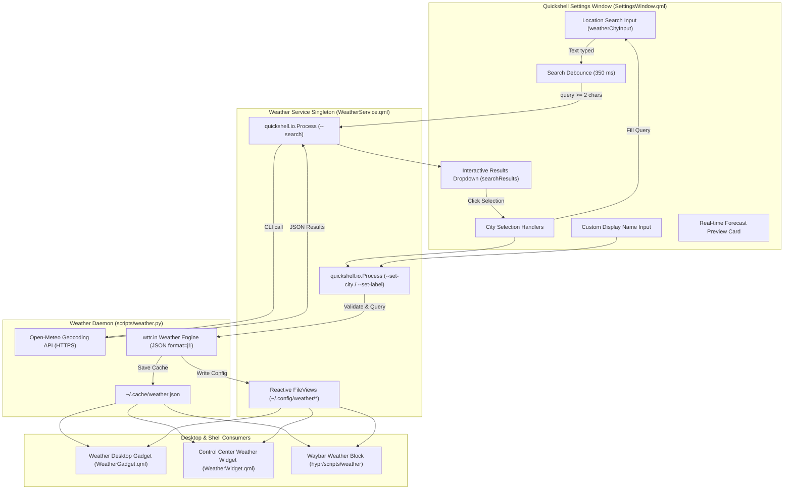

# System Settings & Weather Geolocation

The Quickshell System Settings hub (`quickshell:settings`) is a Wayland-native configuration modal dialog. It unifies user profile management, system telemetry, automated idle locking, and real-time weather geolocation with live geocoding autocompletion into a Material Design 3 interface.

---

## Architecture & Visual Overview



---

## File Structure

```text
quickshell/
├── modules/
│   └── settings/
│       ├── SettingsWindow.qml       # Main modal window with tabbed configuration cards
│       ├── WeatherService.qml       # Asynchronous singleton service for geolocation and weather state
│       ├── ProfileService.qml       # Avatar (~/.face) and display name persistence
│       ├── SystemService.qml        # Real-time hardware telemetry and specs parser
│       ├── LockService.qml          # Hypridle timeout configuration and manual lock actions
│       └── ThemeService.qml         # Accent color extraction and dynamic palette coordination
└── scripts/
    └── weather.py                   # Python CLI daemon with geocoding, wttr.in fallback, and JSON cache
```

---

## Weather & Location Configuration

The **Weather & Location** section allows full control over the physical data source and visual representation of meteorological conditions across the desktop environment.

### 1. Real-Time Geocoding Search & Picker

The location input field incorporates an active search engine powered by Open-Meteo's global geocoding database:

* **Debounced Query Execution:** Initiates search queries 350 ms after the user pauses typing, preventing redundant network requests.
* **Animated Status Indicator:** The search icon transitions into a smooth spinning indicator (`RotationAnimation`) while resolving remote queries.
* **Geographical Deduplication:** Resolves up to 6 unique geographical locations, displaying the city name, administrative region (department, state, or province), and sovereign country.
* **1-Click Selection:** Clicking on any suggested result automatically populates the input field with the normalized ASCII coordinates query (e.g., `Tulua,Colombia`) required by weather providers, instantly closing the selection list.
* **Quick Reset Button:** A dedicated clear action (`✕`) allows clearing both the input field and active search results in a single click.

### 2. Custom Display Name (Labels)

Users can separate the actual meteorological query from its visual presentation on the desktop:

* **Query Source (`Location`):** The physical city or region queried against meteorological servers.
* **Display Name:** An optional, user-defined nickname (e.g., `"La Ciudad del Condor"`). When left empty, the desktop gadgets and status bars cleanly fall back to displaying the primary city name.
* **Dynamic Preview:** An inline preview card immediately illustrates the final formatting that will appear on desktop gadgets, avoiding ambiguous configuration.

### 3. Verification & Persistence Pipeline

When saving changes:

1. `WeatherService.qml` calls `weather.py --set-city <city> --set-label <label>`.
2. The Python daemon tests network connectivity and validates the target location against `wttr.in`.
3. If validated, the configuration is stored in atomic plaintext files:
   * `~/.config/weather/city`
   * `~/.config/weather/label`
4. The atmospheric telemetry is immediately updated in `~/.cache/weather.json`, notifying desktop consumers via reactive signals.

---

## Additional Settings Modules

| Section | Target File | Purpose |
| :--- | :--- | :--- |
| **Profile** | `ProfileService.qml` | Configures system display name and syncs profile avatar with `~/.face` and Hyprlock. |
| **System Info** | `SystemService.qml` | Summarizes kernel, CPU model, GPU acceleration, total RAM, and OS build versions. |
| **Screen Lock** | `LockService.qml` | Manages `hypridle` inactivity timers, preset chips (1m, 5m, 15m, 30m), and manual immediate locking. |
| **Themes** | `ThemeService.qml` | Toggles dynamic Matugen palette generation and custom accent overrides. |

---

## Command Line & IPC Usage

### Geocoding Search via CLI

You can query the backend geocoding engine directly from your terminal:

```bash
# Search for cities matching a term
~/.config/quickshell/scripts/weather.py --search "Medellin"

# Set a new city and custom label
~/.config/quickshell/scripts/weather.py --set-city "Tulua,Colombia" --set-label "La Ciudad del Condor"

# Fetch current structured JSON weather telemetry
~/.config/quickshell/scripts/weather.py
```

### IPC Invocation

To open the Settings window directly from Hyprland or scripts:

```bash
# Open Quickshell Settings modal
qs ipc call settings toggle
```
