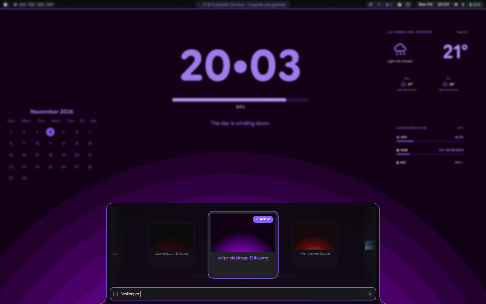

# Wallpaper Engine & Carousel

Quickshell includes a hardware-accelerated desktop background engine and an interactive horizontal wallpaper carousel. It replaces static background setters (like `swaybg` or `hyprpaper`) with fluid zoom-and-blur crossfades, automatic Material Design 3 color extraction, and dynamic multi-monitor management.

---

## Visual Preview



---

## Desktop Background Engine

The background system is defined in `quickshell/modules/background/Background.qml`:

* **Layer Surface:** Operates on `WlrLayershell.layer: WlrLayer.Background` on all active displays (`Quickshell.screens`).
* **Double-Buffer Ping-Pong Architecture:** Uses two alternating `Image` layers. When switching wallpapers, the incoming target loads onto the inactive buffer while the active buffer fades out. This eliminates flicker, memory leaks, and QML property binding degradation across rapid switches.
* **Zoom & Blur (Emergence) Transition:**
  * **Outgoing Image:** Scales from `1.0` to `1.15` while fading opacity from `1.0` to `0.0` over 750 ms (`Easing.InOutQuad`).
  * **Incoming Image:** Scales from `0.88` to `1.0` while fading opacity from `0.0` to `1.0` over 750 ms (`Easing.InOutQuad`).
* **Matugen Orchestration:** After the transition completes, `apply-matugen.sh` is triggered asynchronously only if the active theme is set to `matugen`. If a static or custom theme is active, the theme preference is preserved.

---

## File Structure

```text
quickshell/
├── modules/
│   ├── background/
│   │   └── Background.qml           # Fullscreen background layer with Zoom & Blur transition
│   └── launcher/
│       ├── Launcher.qml             # Overlay host containing the wallpaper carousel state
│       ├── BaseCarouselCard.qml     # Centralized base card component for carousel styling
│       └── WallpaperCard.qml        # 16:9 wallpaper thumbnail card delegate
└── scripts/
    ├── browse-wallpaper.sh          # Zenity native file picker integration
    └── apply-matugen.sh             # Color scheme generator and desktop reload script
```

---

## Wallpaper Carousel Mode

Typing `/wallpaper ` in the launcher or pressing `SUPER + W` (`qs ipc call launcher wallpaper`) brings up the horizontal carousel:

* **Container Geometry:** 1080 px width, 400 px height, with 24 px rounded corners floating above the bottom screen dock.
* **Centered Hero Carousel:**
  * Uses QtQuick's native `highlightRangeMode: ListView.StrictlyEnforceRange` with `preferredHighlightBegin` and `preferredHighlightEnd` dynamically bound to `(width - 260) / 2`.
  * The selected card always stays perfectly centered in the middle of the viewport.
  * Dual 48 px horizontal gradient fade overlays on the left and right flanks smoothly blend off-screen cards into the dark dock background.
* **Hero Sizing & Unified Base Styling (`BaseCarouselCard.qml`):**
  * Displays 224x214 px cards inside 260x276 px cells with 24 px horizontal spacing.
  * **Selected Hero Card:** Scales to `1.25` (`1.28` on hover), with `1.0` opacity, `-8 px` vertical elevation, and `z: 50` layer priority.
  * **Inactive Receded Cards:** Scales to `0.84` (`0.95` on hover) with `0.45` opacity (`0.75` on hover) to create true Cover Flow optical depth.
  * **Clean Unified Border:** Single dynamic border (2 px solid primary on selection, 1.5 px 50% opacity on hover, 1 px subtle panel border when inactive), entirely eliminating floating outer halo artifacts.
  * **Active Badge:** The active desktop wallpaper renders a prominent `Active` badge.
* **Add Local File Card:**
  * The final card in the carousel allows adding arbitrary local images.
  * Clicking or selecting the card launches `browse-wallpaper.sh` using `zenity`, copies the image to the wallpaper directory, caches the preview thumbnail, and immediately applies the new wallpaper.

---

## IPC Commands and Keybindings

```bash
# Open wallpaper carousel directly
qs ipc call launcher wallpaper

# Set a wallpaper programmatically with animated transition
qs ipc call wallpaper set "/path/to/image.png"

# Cycle to next or previous card in carousel
qs ipc call launcher next
qs ipc call launcher prev
qs ipc call launcher activate
```

### Hyprland Keybinding (`~/.config/hypr/binds.conf`)

```ini
# Open wallpaper carousel
bind = $mainMod, W, exec, quickshell ipc call launcher wallpaper
```

---

## Related Documentation

* [Application Launcher](launcher.md): Dynamic Island bottom drawer and command system.
* [Matugen Theming Engine](../apps/matugen.md): Color extraction rules and system palette propagation.
* [Desktop Gadgets](gadgets.md): Ambient desktop widgets floating over the background.
